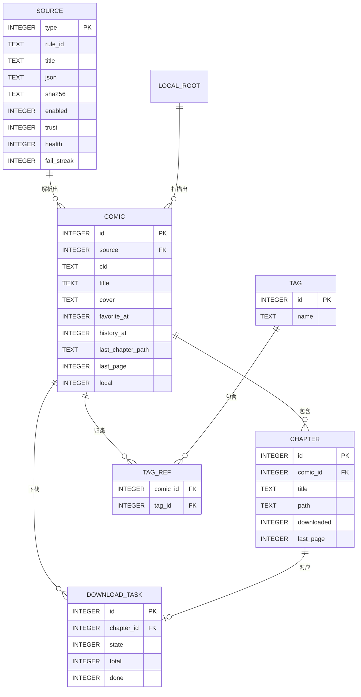

# 04 数据模型

存储：**Room（KSP）** 负责业务实体，**DataStore(Preferences)** 负责设置，**Android Keystore** 负责凭据。`exportSchema = true`，禁止 `fallbackToDestructiveMigration`。

## 1. 实体关系



## 2. Room 配置

```kotlin
// :core:data
room {
    schemaDirectory("$projectDir/schemas")
}

ksp {
    arg("room.schemaLocation", "$projectDir/schemas")
    arg("room.generateKotlin", "true")
}
```

依赖：`androidx.room:room-runtime`、`room-ktx`、`room-paging`，处理器 `room-compiler`（KSP）。数据库声明：

```kotlin
@Database(
    entities = [SourceEntity::class, ComicEntity::class, ChapterEntity::class,
        TagEntity::class, TagRefEntity::class, DownloadTaskEntity::class,
        SearchHistoryEntity::class, LocalRootEntity::class, AppMetaEntity::class],
    version = 1,
    exportSchema = true,
)
abstract class MangaDatabase : RoomDatabase() {
    abstract fun sourceDao(): SourceDao
    abstract fun comicDao(): ComicDao
    abstract fun chapterDao(): ChapterDao
    // …
}
```

业务模型（`:core:model`）与实体分离：`ComicEntity ↔ Comic` 通过 `EntityMapper` 转换，UI 只见业务模型。

## 3. 表定义

### 3.1 `source`（已安装规则 = 源实例）

```sql
CREATE TABLE source (
    type            INTEGER PRIMARY KEY AUTOINCREMENT,  -- 源类型 ID（>0；本地库为 0）
    rule_id         TEXT    NOT NULL,
    title           TEXT    NOT NULL,
    version         TEXT    NOT NULL,
    schema_version  INTEGER NOT NULL,
    engine_min      INTEGER NOT NULL,
    base_url        TEXT,
    json            TEXT    NOT NULL,                   -- 规范化后的规则全文
    sha256          TEXT    NOT NULL,
    enabled         INTEGER NOT NULL DEFAULT 1,
    trust           INTEGER NOT NULL DEFAULT 1,         -- 0=OFFICIAL 1=COMMUNITY 2=LOCAL
    origin_url      TEXT,
    installed_at    INTEGER NOT NULL,
    last_used_at    INTEGER,
    health          INTEGER NOT NULL DEFAULT 0,         -- 0=HEALTHY 1=DEGRADED 2=DISABLED
    fail_streak     INTEGER NOT NULL DEFAULT 0,
    last_fail_at    INTEGER,
    last_error_code TEXT,
    sort            INTEGER NOT NULL DEFAULT 0
);
CREATE UNIQUE INDEX idx_source_rule_id ON source(rule_id);
CREATE INDEX idx_source_enabled ON source(enabled, sort);
```

Kotlin 实体：

```kotlin
@Entity(
    tableName = "source",
    indices = [Index(value = ["rule_id"], unique = true), Index("enabled", "sort")],
)
data class SourceEntity(
    @PrimaryKey(autoGenerate = true) val type: Long = 0,
    @ColumnInfo(name = "rule_id") val ruleId: String,
    val title: String,
    val version: String,
    @ColumnInfo(name = "schema_version") val schemaVersion: Int,
    @ColumnInfo(name = "engine_min") val engineMin: Int,
    @ColumnInfo(name = "base_url") val baseUrl: String?,
    val json: String,
    val sha256: String,
    val enabled: Boolean = true,
    val trust: Int = 1,
    @ColumnInfo(name = "origin_url") val originUrl: String? = null,
    @ColumnInfo(name = "installed_at") val installedAt: Long,
    @ColumnInfo(name = "last_used_at") val lastUsedAt: Long? = null,
    val health: Int = 0,
    @ColumnInfo(name = "fail_streak") val failStreak: Int = 0,
    @ColumnInfo(name = "last_fail_at") val lastFailAt: Long? = null,
    @ColumnInfo(name = "last_error_code") val lastErrorCode: String? = null,
    val sort: Int = 0,
)
```

约定：
- `type = 0` 保留给本地漫画（`source.local`），不写入本表。
- `rule_id` 全局唯一；重新导入同 id 视为升级，保留 `type`/`enabled`，重置 `failStreak`。
- `health` 状态机见 [05 §8](05-source-rule-spec.md#8-健康度与撤销)。

### 3.2 `comic`

```sql
CREATE TABLE comic (
    id                  INTEGER PRIMARY KEY AUTOINCREMENT,
    source              INTEGER NOT NULL DEFAULT 0,
    cid                 TEXT    NOT NULL,
    title               TEXT    NOT NULL,
    cover               TEXT    NOT NULL DEFAULT '',
    author              TEXT,
    intro               TEXT,
    update_text         TEXT,
    update_at           INTEGER,
    finish              INTEGER,                        -- null=未知 0=连载 1=完结
    highlight           INTEGER NOT NULL DEFAULT 0,
    local               INTEGER NOT NULL DEFAULT 0,
    favorite_at         INTEGER,                        -- 非空即收藏
    history_at          INTEGER,
    downloaded_at       INTEGER,
    last_chapter_path   TEXT,
    last_chapter_title  TEXT,
    last_chapter_index  INTEGER,
    last_page           INTEGER NOT NULL DEFAULT 0,     -- 0-based
    chapter_count       INTEGER NOT NULL DEFAULT 0,
    url                 TEXT
);
-- 注意：source 为 0 表示本地漫画，没有对应的 source 行，因此不建外键；
-- 孤立数据的清理由 Repository 在删除源时显式完成。
CREATE UNIQUE INDEX idx_comic_source_cid ON comic(source, cid);
CREATE INDEX idx_comic_favorite ON comic(favorite_at) WHERE favorite_at IS NOT NULL;
CREATE INDEX idx_comic_history  ON comic(history_at)  WHERE history_at IS NOT NULL;
CREATE INDEX idx_comic_source   ON comic(source);
CREATE INDEX idx_comic_highlight ON comic(highlight) WHERE highlight = 1;
```

与 Cimoc `Comic` 的字段对照（便于读参考实现）：

| 本项目 | Cimoc | 说明 |
| --- | --- | --- |
| `favorite_at` | `favorite` | 时间戳，非空即收藏 |
| `history_at` | `history` | 同上 |
| `downloaded_at` | `download` | 同上 |
| `update_text` | `update` | 保留源返回文本 |
| `last_chapter_path` | `chapter` | 改存稳定 path |
| `last_page` | `page` | 0-based |
| `chapter_count` | — | 新增，用于未读与进度 |

DAO 片段：

```kotlin
@Dao
interface ComicDao {
    @Query("SELECT * FROM comic WHERE favorite_at IS NOT NULL ORDER BY favorite_at DESC")
    fun shelf(): Flow<List<ComicEntity>>

    @Query("SELECT * FROM comic WHERE source = :source AND cid = :cid LIMIT 1")
    suspend fun find(source: Long, cid: String): ComicEntity?

    @Insert(onConflict = OnConflictStrategy.IGNORE)
    suspend fun insert(entity: ComicEntity): Long

    @Query("""UPDATE comic SET favorite_at = :at WHERE id = :id""")
    suspend fun setFavorite(id: Long, at: Long?)

    @Query("""UPDATE comic SET last_chapter_path = :path, last_chapter_title = :title,
              last_chapter_index = :index, last_page = :page, history_at = :at WHERE id = :id""")
    suspend fun saveProgress(id: Long, path: String, title: String, index: Int, page: Int, at: Long)
}
```

> 注意：`upsert` 用 `INSERT IGNORE` + `UPDATE` 分两步实现「保留本地状态、只刷新元数据」，避免 `REPLACE` 触发级联删除。

### 3.3 `chapter`

```sql
CREATE TABLE chapter (
    id           INTEGER PRIMARY KEY AUTOINCREMENT,
    comic_id     INTEGER NOT NULL,
    title        TEXT    NOT NULL,
    path         TEXT    NOT NULL,
    source_group TEXT    NOT NULL DEFAULT '',
    count        INTEGER NOT NULL DEFAULT 0,
    complete     INTEGER NOT NULL DEFAULT 0,
    downloaded   INTEGER NOT NULL DEFAULT 0,
    last_page    INTEGER NOT NULL DEFAULT 0,
    read_at      INTEGER,
    size_bytes   INTEGER NOT NULL DEFAULT 0,
    FOREIGN KEY (comic_id) REFERENCES comic(id) ON DELETE CASCADE
);
CREATE UNIQUE INDEX idx_chapter_comic_path ON chapter(comic_id, path);
CREATE INDEX idx_chapter_comic ON chapter(comic_id, id);
CREATE INDEX idx_chapter_downloaded ON chapter(comic_id, downloaded);
```

约定：
- 刷新章节以 `path` 对齐：同 path 更新标题；新 path 插入；消失的 path 标记 `complete = -1`（保留进度），不物理删除。
- 惰性章节首次完整阅读后回填 `count`。
- `read_at` 非空即「读过」，`last_page >= count - 1` 视为读完（`count = 0` 时以 `read_at` 为准）。

### 3.4 `tag` / `tag_ref`

```sql
CREATE TABLE tag (
    id   INTEGER PRIMARY KEY AUTOINCREMENT,
    name TEXT NOT NULL,
    sort INTEGER NOT NULL DEFAULT 0
);
CREATE UNIQUE INDEX idx_tag_name ON tag(name);

CREATE TABLE tag_ref (
    comic_id INTEGER NOT NULL,
    tag_id   INTEGER NOT NULL,
    PRIMARY KEY (comic_id, tag_id),
    FOREIGN KEY (comic_id) REFERENCES comic(id) ON DELETE CASCADE,
    FOREIGN KEY (tag_id)   REFERENCES tag(id)   ON DELETE CASCADE
);
```

`name` 入库前做 `trim` + 大小写折叠（`lowercase(Locale.ROOT)`）用于唯一性，展示用原名另存 `display_name`（P1）。

### 3.5 `download_task`

```sql
CREATE TABLE download_task (
    id           INTEGER PRIMARY KEY AUTOINCREMENT,
    comic_id     INTEGER NOT NULL,
    chapter_id   INTEGER NOT NULL,
    source       INTEGER NOT NULL,
    cid          TEXT    NOT NULL,
    chapter_path TEXT    NOT NULL,
    title        TEXT    NOT NULL,
    state        INTEGER NOT NULL,          -- 0 排队 1 运行 2 暂停 3 完成 4 失败 5 取消
    total        INTEGER NOT NULL DEFAULT 0,
    done         INTEGER NOT NULL DEFAULT 0,
    failed       INTEGER NOT NULL DEFAULT 0,
    target_dir   TEXT    NOT NULL,
    error_code   TEXT,
    error_msg    TEXT,
    created_at   INTEGER NOT NULL,
    updated_at   INTEGER NOT NULL,
    FOREIGN KEY (chapter_id) REFERENCES chapter(id) ON DELETE CASCADE,
    FOREIGN KEY (comic_id)   REFERENCES comic(id)   ON DELETE CASCADE
);
CREATE UNIQUE INDEX idx_task_chapter ON download_task(chapter_id);
CREATE INDEX idx_task_state ON download_task(state, created_at);
```

### 3.6 `search_history`

```sql
CREATE TABLE search_history (
    id         INTEGER PRIMARY KEY AUTOINCREMENT,
    keyword    TEXT NOT NULL,
    source     INTEGER NOT NULL DEFAULT -1,
    created_at INTEGER NOT NULL
);
CREATE UNIQUE INDEX idx_search_unique ON search_history(keyword, source);
CREATE INDEX idx_search_time ON search_history(created_at DESC);
```

保留最近 20 条：插入（`IGNORE` 冲突则更新时间）→ 按时间倒序删除第 21 条之后。

### 3.7 `local_root`

```sql
CREATE TABLE local_root (
    id         INTEGER PRIMARY KEY AUTOINCREMENT,
    uri        TEXT NOT NULL,
    label      TEXT NOT NULL,
    enabled    INTEGER NOT NULL DEFAULT 1,
    last_scan  INTEGER,
    last_count INTEGER NOT NULL DEFAULT 0
);
CREATE UNIQUE INDEX idx_root_uri ON local_root(uri);
```

### 3.8 `app_meta`

```sql
CREATE TABLE app_meta (
    key   TEXT PRIMARY KEY,
    value TEXT
);
```

仅存 `last_update_check`、`last_backup_at`、`install_id`（随机 UUID，本地）、`schema_seeded` 等小型元数据。

## 4. 设置（DataStore）

```kotlin
val Context.settings: DataStore<Preferences> by preferencesDataStore("settings")

object SettingsKeys {
    val readerMode = stringPreferencesKey("reader.mode")           // PAGED_LTR…
    val prefetchForward = intPreferencesKey("reader.prefetch.forward")
    val prefetchBackward = intPreferencesKey("reader.prefetch.backward")
    val volumeKeys = booleanPreferencesKey("reader.volumeKeys")
    val autoCrop = booleanPreferencesKey("reader.autoCrop")
    val longImageSlice = booleanPreferencesKey("reader.longImageSlice")
    val keepScreenOn = booleanPreferencesKey("reader.keepScreenOn")
    val fullscreen = booleanPreferencesKey("reader.fullscreen")
    val brightness = floatPreferencesKey("reader.brightness")
    val nightFilter = stringPreferencesKey("reader.nightFilter")
    val themeMode = stringPreferencesKey("theme.mode")
    val dynamicColor = booleanPreferencesKey("theme.dynamicColor")
    val blackTheme = booleanPreferencesKey("theme.black")
    val timeoutMs = intPreferencesKey("net.timeoutMs")
    val imageConcurrency = intPreferencesKey("net.imageConcurrency")
    val imageCacheMb = intPreferencesKey("storage.imageCacheMb")
    val downloadRoot = stringPreferencesKey("storage.downloadRoot")
    val crashLog = booleanPreferencesKey("privacy.crashLog")
}
```

完整键表：

| 键 | 类型 | 默认 | 说明 |
| --- | --- | --- | --- |
| `reader.mode` | enum | PAGED_LTR | PAGED_LTR / PAGED_RTL / PAGED_TTB / WEBTOON |
| `reader.prefetch.forward` | int | 3 | 0–8 |
| `reader.prefetch.backward` | int | 1 | 0–4 |
| `reader.volumeKeys` | bool | true | 音量键翻页 |
| `reader.autoCrop` | bool | false | 白边裁剪 |
| `reader.longImageSlice` | bool | true | 长图切片 |
| `reader.keepScreenOn` | bool | true | 阅读时亮屏 |
| `reader.fullscreen` | bool | true | 沉浸模式 |
| `reader.brightness` | float | -1 | 跟随系统 |
| `reader.nightFilter` | enum | NONE | NONE / WARM / DIM |
| `theme.mode` | enum | SYSTEM | SYSTEM / LIGHT / DARK |
| `theme.dynamicColor` | bool | true | Material You |
| `theme.black` | bool | false | OLED 纯黑 |
| `net.timeoutMs` | int | 15000 | 页面请求 |
| `net.imageConcurrency` | int | 2 | 每源图片并发 |
| `storage.imageCacheMb` | int | 512 | 128–2048 |
| `storage.downloadRoot` | string | app-private | SAF uri |
| `privacy.crashLog` | bool | true | 仅本地 |
| `backup.auto.daily` | bool | false | 每日备份 |

设置读取：`Flow<Settings>` 用 `map` 聚合，避免多个 `collect` 造成重复重组。

## 5. 迁移策略

- 起始 `version = 1`，schema 文件入库并与代码同 PR；CI 校验 schema 变更。
- 每版本提供显式 `Migration(n, n+1)` + `MigrationTestHelper` 用例（旧 schema 建库 → 迁移 → 断言数据）。
- 破坏性变更三段式：新增列（可空）→ 后台回填 → 下版本删旧列。禁止直接 `DROP/ALTER` 丢数据。
- 规则 `schemaVersion` 与 DB 版本解耦；规则不兼容时禁用并保留 JSON 供导出。
- 备份 `formatVersion` 高于 App → 拒绝并提示升级；低于 → 顺序执行转换器（`BackupV1ToV2`…）。

## 6. 备份格式（`*.mangareader.zip`）

```
backup-20260101-120000.mangareader.zip
├── manifest.json
├── sources.json
├── library.json
├── tags.json
├── downloads.json
└── settings.json
```

```json
// manifest.json
{
  "formatVersion": 1,
  "appVersion": "1.0.0",
  "dbVersion": 1,
  "exportedAt": 1767225600000,
  "counts": { "sources": 3, "comics": 128, "tags": 6 },
  "checksum": { "algorithm": "sha256", "value": "…" }
}
```

```json
// library.json 单条
{
  "sourceRuleId": "community.example",
  "cid": "12345",
  "title": "示例漫画",
  "author": "作者",
  "cover": "https://example.com/cover.jpg",
  "favoriteAt": 1767000000000,
  "historyAt": 1767220000000,
  "progress": { "chapterPath": "/chapter/88/", "chapterIndex": 87, "page": 12 },
  "chapters": [
    { "path": "/chapter/87/", "title": "第87话", "downloaded": true, "readAt": 1767210000000 }
  ],
  "tags": ["连载中", "已下载"]
}
```

序列化用 `kotlinx.serialization`：

```kotlin
@Serializable
data class LibraryEntry(
    val sourceRuleId: String,
    val cid: String,
    val title: String,
    val author: String? = null,
    val cover: String = "",
    val favoriteAt: Long? = null,
    val historyAt: Long? = null,
    val progress: ProgressDto? = null,
    val chapters: List<ChapterDto> = emptyList(),
    val tags: List<String> = emptyList(),
    val extra: JsonObject? = null,     // 未知字段原样保留
)
```

`Json { ignoreUnknownKeys = true; encodeDefaults = true; explicitNulls = false }`；未知字段收进 `extra`，恢复时原样写回，避免旧版本覆盖丢数据。

恢复策略：

| 模式 | 行为 |
| --- | --- |
| **合并（默认）** | 按 `(sourceRuleId, cid)` 匹配；收藏/进度取时间较新者；标签并集；同 `ruleId` 升级到较高版本 |
| 替换 | 清空后导入（二次确认，提示未备份数据会丢失） |
| 仅规则 | 只导入 `sources.json` |
