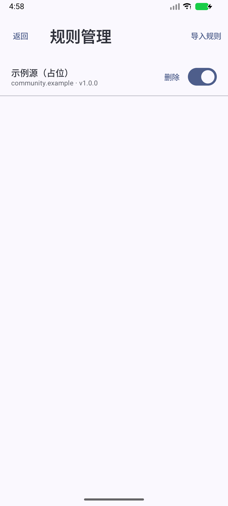
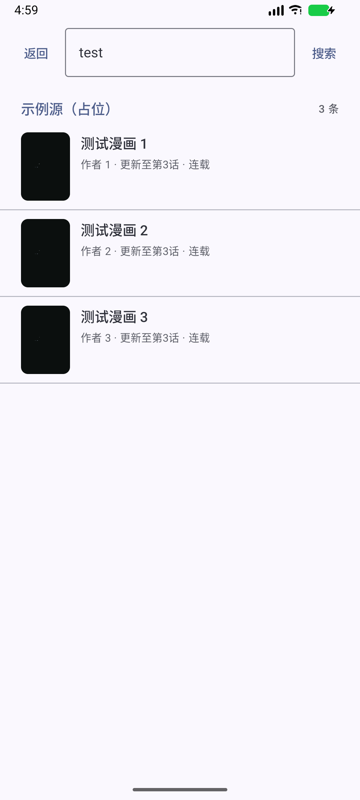

# M3 验证记录

日期：2026-11-04 · 范围：主流程闭环（规则 → 搜索 → 详情 → 阅读 → 书架/历史）

## 交付

| 能力 | 实现 |
| --- | --- |
| 规则管理 | 列表/启停/删除、粘贴剪贴板导入、JSON Pointer 错误展示；编译结果缓存 |
| 聚合搜索 | `SearchCoordinator` 每源并发、先到先发、单源超时 15s、失败互不影响；健康度成功/失败上报 |
| 搜索结果 | 按源分组、封面/作者/状态、失败行 + 重试 |
| 详情 | 详情拉取与入库、章节合并（path 稳定键）、收藏、继续阅读（恢复上次章节） |
| 阅读 | `ReaderRoute` 加载真实章节：规则 → 图片列表（支持 lazy）→ ReaderScreen；进度写 `comic`/`chapter` |
| 书架 | 收藏网格、封面、上次章节、检查更新（4 并发、失败不回滚旧值） |
| 历史 | 按 `history_at` 倒序、页码与时间 |
| Debug 假源 | `tools/devserver/serve.py` + debug-only `DevInstallActivity`/`dev_rule.json`（release 不含规则） |

## 端到端验证（Android 16 模拟器）

使用本地假源（`http://10.0.2.2:8765`，仅占位图，无任何真实内容）：

1. `adb shell am start -n …/.DevInstallActivity` → 安装规则（日志 `installed dev rule`）。
2. 规则管理显示「示例源（占位）v1.0.0」。
3. 浏览 → 输入 `test` → 搜索结果 3 条（服务端收到 `/search?q=test&page=1`）。
4. 点击结果 → 详情页：标题/作者/简介/3 章（逆序规则生效），服务端收到 `/comic/1/`。
5. 点击第 1 话 → 阅读器显示图片（`/chapter/1/1/`、`/img/1/11.png`），进度回调写入数据库。
6. 收藏 → 返回 → 历史出现「测试漫画 1 · 第1话」；书架出现该漫画。
7. 书架「检查更新」→「检查完成：1 部，更新 0 部」，服务端收到 `/comic/1/`，源健康度重置。

截图见下。

## 自动化测试

| 套件 | 说明 |
| --- | --- |
| `:core:source:test` | 43 项（M1 规则引擎，含 MockWebServer 端到端） |
| `:core:reader:test` | 12 项（控制器/缩放/双页） |
| `:core:data` 仪器化迁移测试 | v1→v2 建表与 schema 校验通过 |

> **UTP 说明**：`./gradlew connectedDebugAndroidTest` 在 Windows + 模拟器路径下出现 `Failed to receive the UTP test results`（UTP 启动失败，非测试失败）。直接执行等价命令可通过：
> `adb install -r core/data/build/outputs/apk/androidTest/debug/data-debug-androidTest.apk && adb shell am instrument -w io.github.saonte.mangareader.data.test/androidx.test.runner.AndroidJUnitRunner`
> 结果：`OK (1 test)`。

## 截图

| 规则管理 | 聚合搜索 | 详情 |
| --- | --- | --- |
|  |  |  |

| 在线阅读 | 书架 + 检查更新 | 历史 |
| --- | --- | --- |
|  |  |  |

## 已知缺口（顺延）

| 项 | 去向 |
| --- | --- |
| 搜索历史持久化（`search_history` 表已有，未接 UI） | M4 |
| 惰性章节总页数未知时的「下一页探测」 | M4 |
| 多规则矩阵（5 条不同结构规则）手工验收 | M5 规则生态 |
| 冷启动 ≤1.5s、500 收藏滚动、20 部更新 ≤30s | M7 真机基准 |
| 平板上双页横图配对 | M7 |
| 搜索协调器单测（当前依赖端到端验证） | M4 补 |
