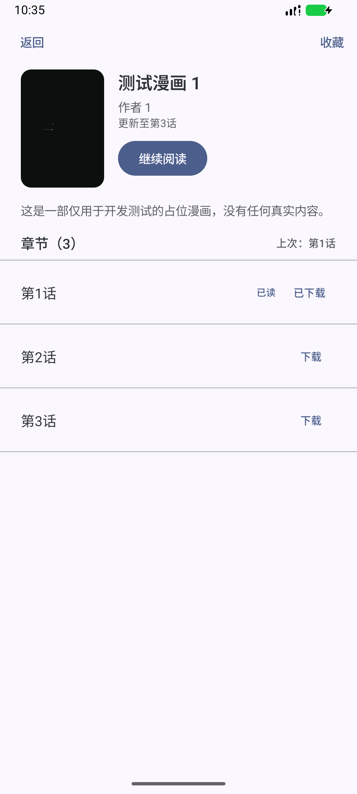

# M4 验证记录（进行中）

日期：2026-11-04 · 范围：下载与离线阅读（本地漫画顺延）

## 已完成

| 能力 | 实现 |
| --- | --- |
| 下载队列 | WorkManager（`HiltWorker`）+ 唯一任务 `dl:<chapterId>`，可排队/暂停/继续/删除 |
| 前台服务 | WorkManager `ForegroundInfo` + `dataSync` 类型；通知渠道 `downloads`，进度/完成通知 |
| 断点续传 | 已存在且非空的页跳过；`.part` 写入后原子改名 |
| 图片下载 | `SourceHttpClient.fetchImageBytes`：host 白名单（含 imageHosts）、页级 Referer、32MB 上限 |
| 进度与状态 | `download_task` 实时进度；完成回写 `chapter.downloaded` 与 `comic.downloaded_at` |
| 离线阅读 | `FilePageSource`（file:// + 自然排序）；`ReaderViewModel` 优先使用已完成下载目录 |
| 离线详情 | 详情优先展示 DB 缓存；刷新失败时提示「离线：显示已缓存内容」而非整页报错 |
| 下载管理页 | 列表 + 进度条 + 暂停/继续/删除；入口「我的 → 下载管理」 |
| 章节下载入口 | 详情页每章「下载/已下载/进度/继续/重试」 |
| 本地目录扫描 | SAF tree / file://，`root/漫画/章节/图片`；自然排序、封面、章节页数、增量刷新（重复扫描 upsert） |
| 本地库页面 | 添加/移除目录、扫描全部、本地漫画网格、移除漫画 |
| 本地阅读 | `LocalPageSource` 支持 file:// 与 content://，按相对路径遍历章节目录 |

## 设备验证（Android 16 模拟器 + 本地假源）

1. 详情页点击「下载」→ WorkManager 启动 `DownloadWorker`。
2. 服务端收到 `/chapter/1/1/` 与 `/img/1/11.png`、`/img/1/12.png`、`/img/1/13.png`，本地落盘 `001.png`…`003.png`。
3. 下载管理显示「第1话 · 已完成」。
4. 关闭 Wi-Fi + 移动数据：
   - 历史 → 详情显示缓存（提示「离线：显示已缓存内容」）；
   - 点击章节进入阅读器，正常渲染本地图片。
5. 无 FATAL/ANR（下载与离线阅读）。

## 修复记录

| 问题 | 修复 |
| --- | --- |
| WorkManager 约束 `CONNECTED` 在模拟器上要求 `VALIDATED`，任务永不执行 | 改为 `NOT_REQUIRED`（失败由 Worker 重试 + UI 错误兜底），并用 `REPLACE` 替换旧约束任务 |
| `SystemForegroundService` 未声明 `foregroundServiceType`，startForeground 崩溃 | Manifest 合并 `<service … android:foregroundServiceType="dataSync">` |
| 下载 Worker 注入 `SourceHttpClient` 缺失 | `SourceModule` 提供单例 Client，Engine 复用 |

## 本地漫画验证（Android 16 模拟器）

1. 我的 → 本地漫画 → 「生成本地演示目录（Debug）」：生成 2 部 × 2 话 × 3 页占位图并注册为 root。
2. 扫描完成：2 部漫画、目录列表显示「上次扫描 2 部」。
3. 打开《测试本地漫画 1》→ 详情显示 2 话、每话 3 页。
4. 点击第 1 话 → 阅读器直接读取本地图片（无网络请求）。

## 截图

| 下载管理 | 离线详情 | 离线阅读 |
| --- | --- | --- |
|  |  |  |

| 本地库 | 本地详情 | 本地阅读 |
| --- | --- | --- |
|  | 见报告 |  |

## 待完成（M4 收尾）

| 项 | 说明 |
| --- | --- |
| ZIP / CBZ | 目录型已支持；ZIP/CBZ 需 entry 索引 + 缓存解压，顺延 M7 |
| 封面缩略图 | 当前直接加载原图，大图目录需缩略图（M7 性能） |
| 下载设置 | 并发数、仅 Wi-Fi、存储目录、清理孤立文件 |
| 批量下载 | 「下载全部/选中章节」与队列排序 |
| 断网恢复 | 网络切换后自动续传（当前依赖 WorkManager 重试/手动继续） |
| 下载测试 | `DownloadWorker` 的 Instrumentation/WorkManager TestDriver 用例 |
