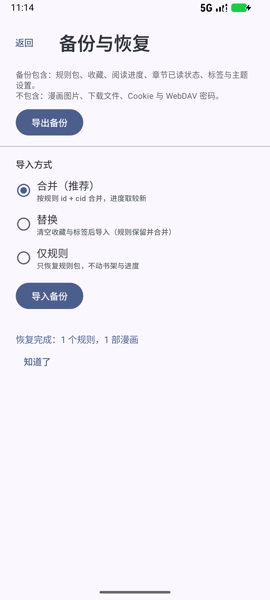
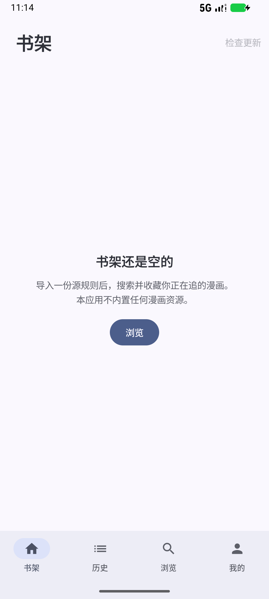
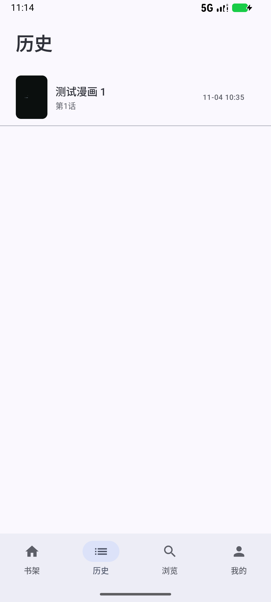

# M6 验证记录

日期：2026-11-04 · 范围：备份/恢复、设置页

## 已完成

| 能力 | 实现 |
| --- | --- |
| 备份格式 | ZIP：`manifest.json` / `sources.json` / `library.json` / `tags.json` / `settings.json` |
| 完整性 | manifest 版本 + 条目计数 + 内容 SHA-256 校验；不匹配拒绝导入 |
| 导出 | SAF `CreateDocument` 选择位置；包含规则、收藏、章节已读、进度、标签、主题 |
| 导入 | SAF `OpenDocument`；三种模式：合并（默认）/ 替换 / 仅规则 |
| 合并策略 | 收藏/历史取较新；进度按 `historyAt` 较新者；标签并集；规则同 id 升级 |
| 排除内容 | 漫画图片、下载文件、Cookie、WebDAV 凭据（符合 docs/04） |
| 设置页 | 主题（跟随系统/浅色/深色）+ 规则/下载/本地/备份入口 |

## 端到端验证（Android 16 模拟器）

1. 已有数据：1 个规则、1 部收藏、1 条历史、1 章已下载。
2. 我的 → 备份与恢复 → 导出：系统保存到 `Download/mangareader-backup-20261104-1113.zip`（3.08 kB）。
3. `pm clear` 清空应用数据 → 重新安装 → 打开导入 → 选择备份 → 合并模式。
4. 提示「恢复完成：1 个规则，1 部漫画」。
5. 书架恢复收藏；历史恢复「测试漫画 1 · 第1话 · 10:35」；规则管理恢复规则。

## 截图

| 导入结果 | 恢复后的书架 | 恢复后的历史 |
| --- | --- | --- |
|  |  |  |

## 顺延

| 项 | 说明 |
| --- | --- |
| WebDAV 备份 | P1；M6 只做本地文件，WebDAV 客户端（PROPFIND/PUT/GET）顺延 M7 |
| 自动每日备份 | 需 WorkManager 周期任务与保留策略 |
| 阅读设置落库 | 翻页方向/预取页数/音量键等尚未接入 Reader，当前为固定默认值（M7） |
| 备份加密 | 当前不加密（可读、可迁移）；包含凭据前必须加密 |

## 已知限制

- 下载文件不在备份内；恢复后章节标记为「未下载」，需重新下载（避免指向不存在的文件）。
- 本地漫画不入备份（文件在设备上，路径不可迁移）。
