# M7 验证记录（进行中）

日期：2026-11-04 · 范围：发布配置、阅读设置、批量下载、更新筛选

## 已完成

| 能力 | 实现 |
| --- | --- |
| 版本 | `versionCode 10` / `versionName 1.0.0` |
| Release 构建 | R8 minify + resource shrink；缺失 jsoup Re2J 类用 `-dontwarn`；Rhino/serialization keep 规则 |
| 签名 | `MANGA_KEYSTORE_FILE/PASSWORD/KEY_ALIAS/KEY_PASSWORD` 环境变量；无密钥时回退 debug 签名（仅供验证） |
| CI | PR 门禁新增 `:app:assembleRelease`（R8 编译验证）；`release.yml` 在 `v*` tag 构建 APK 并发布 GitHub Release |
| 阅读设置 | 默认模式（左→右/右→左/上下/条漫）与双页开关持久化（DataStore），阅读器即时生效 |
| 阅读菜单 | 模式按钮循环四种模式并显示当前方向 |
| 批量下载 | 详情页「下载全部」按章入队，跳过已下载/已有任务 |
| 更新筛选 | 书架「仅更新」/「全部」，无更新时独立空态 |
| Edge-to-edge | `enableEdgeToEdge()`（API 35 强制边到边） |
| 搜索分页（F-203） | 每源「加载更多」，按 `source+cid` 去重，`hasNext` 由规则 paging 决定 |
| 章节排序（F-302） | 详情页「正序/倒序」切换并持久化（DataStore） |
| 点击区（F-405） | 左/中/右三区独立配置（上一页/下一页/菜单），持久化并即时生效 |
| 阅读菜单（F-406） | 亮度滑杆（遮罩，不改系统设置）、夜间滤镜、自动裁剪开关 |
| 书架多选（F-101） | 长按进入多选，取消/全选/批量取消收藏 |
| 历史管理（F-106） | 单条删除、清空（二次确认），仅清历史不影响收藏 |
| 更新列表（F-104） | 进入详情即清除 highlight；书架「仅更新」为空时显示独立空态 |
| 章节批量下载（F-305） | 章节长按多选 → 下载所选（跳过已下载） |
| 章节失效回退（F-303） | 上次章节被源删除时按索引回退到最近章节，阅读器顶部提示「原章节已失效」 |
| 无障碍 | 阅读器文案抽到 `core:reader` 的 strings（en/zh-rTW）；页面图片补充 `contentDescription` 与语义节点；底部导航沿用可见 label |
| 备份策略 | `dataExtractionRules`：规则/书架/进度/设置随设备迁移，排除下载图片与缓存 |
| i18n（en / zh-rTW） | 书架/历史/下载/搜索/详情/设置/规则/本地/备份页面文案全部抽到 `strings.xml`；`values-en` 与 `values-zh-rTW` 各 133 条；`values` 声明 `tools:locale="zh"` |

## Release 构建验证

```
./gradlew :app:assembleRelease --no-daemon --max-workers=2
BUILD SUCCESSFUL in 3m 3s
app-release.apk  2.7 MB
```

- 安装到 Android 16 模拟器（release 包名无 `.debug`），冷启动正常、无 FATAL。
- Debug 包保留本地假源/演示入口；release 包不含 `DevInstallActivity` 与 dev assets。

## 截图

| Release 启动 | 阅读设置 | 点击区设置 |
| --- | --- | --- |
|  | 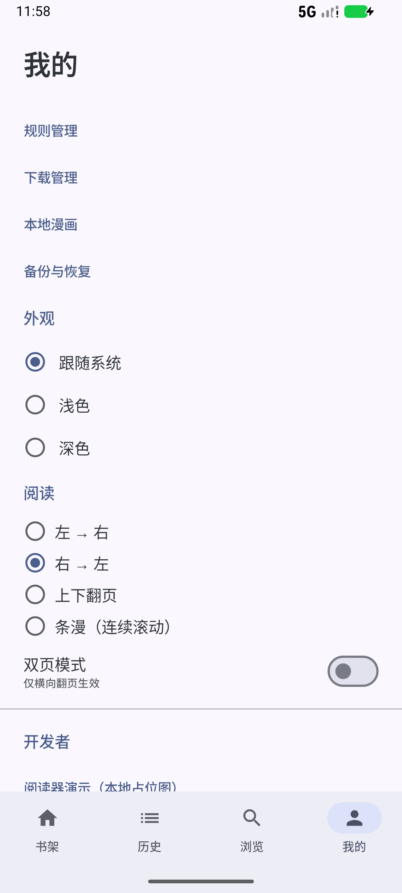 | 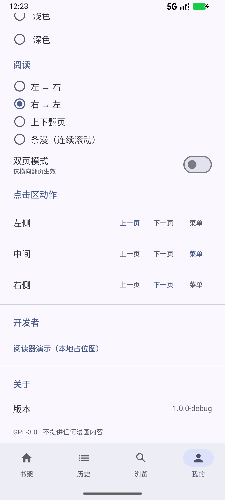 |

| 英文界面 | 繁体界面 |
| --- | --- |
| 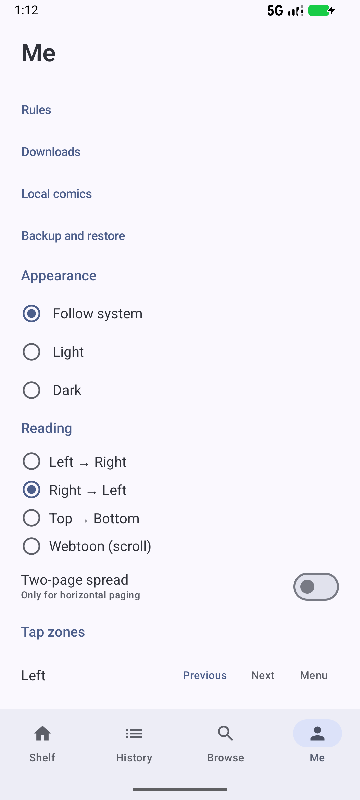 | 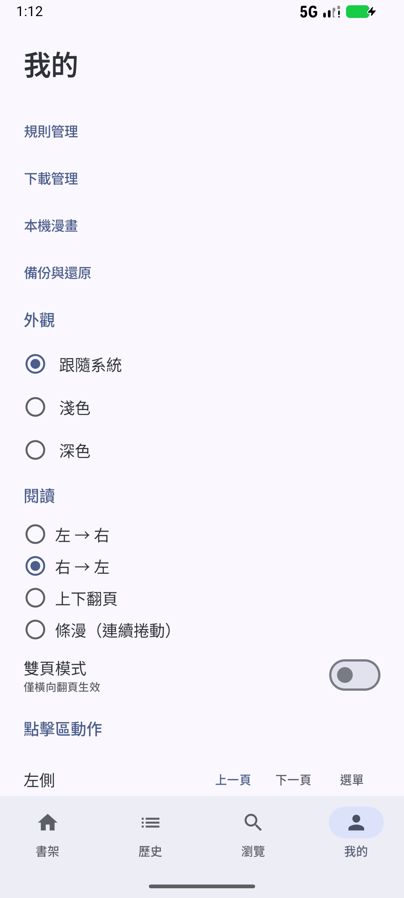 |

| 搜索分页 | 章节倒序 | 阅读菜单 |
| --- | --- | --- |
| 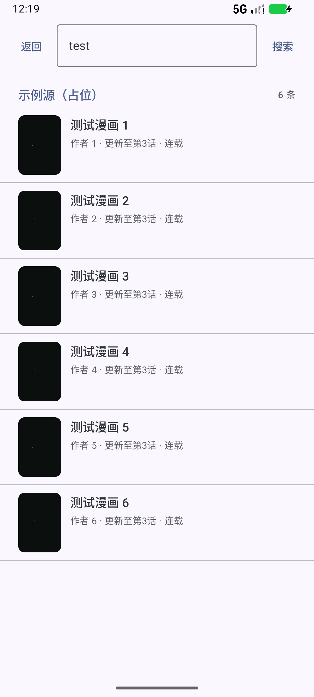 | 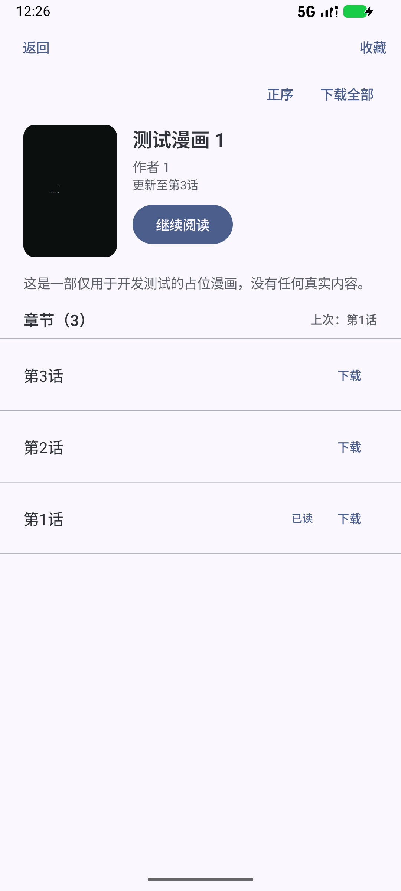 |  |

| 书架多选 | 历史管理 | 章节多选 |
| --- | --- | --- |
| 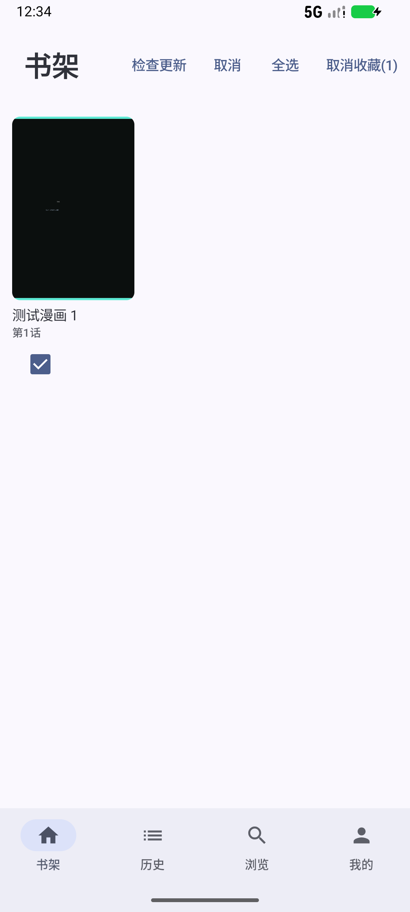 | 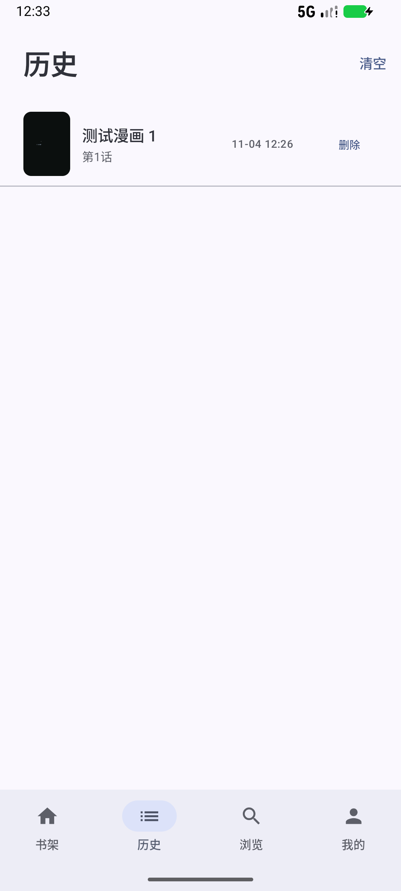 | 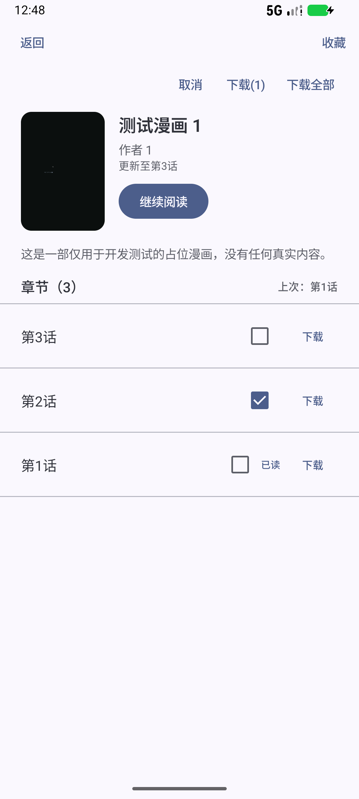 |

| 仅更新（有更新） | 仅更新（已读后为空） |
| --- | --- |
| 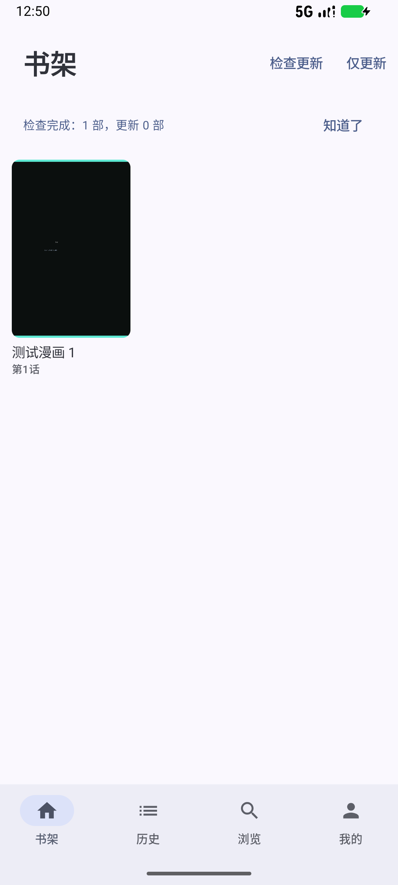 | 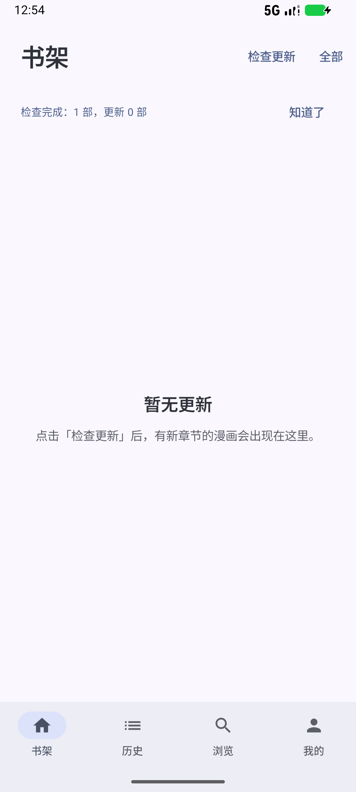 |

## 性能实测（Android 16 模拟器，Medium Phone API 36.1）

| 指标 | 实测 | 预算（NFR） | 结论 |
| --- | --- | --- | --- |
| Release 冷启动 → 可交互 | 786 / 805 / 856 / 1083 ms | ≤ 1500 ms | ✅ |
| Debug 冷启动 | 2974–4222 ms | — | 参考（debug 未混淆、含调试开销） |
| Release APK 大小 | 2.7 MB | ≤ 15 MB | ✅ |
| 覆盖升级 | `install -r` 成功，数据保留，重启无崩溃 | 可覆盖升级 | ✅ |

> 说明：模拟器非 Pixel 4a 级真机，数据仅作回归基线；Macrobenchmark 与 Baseline Profile 顺延 1.0.1（见下方顺延表）。

## 验证数据

- 搜索分页：第 1 页 3 条 + 「还有更多」→ 点「加载更多」→ 6 条（`/search?q=test&page=2` 返回 4/5/6）。
- 章节倒序：详情页切换后顺序变为 第3话 → 第2话 → 第1话，重启应用后保持。
- 点击区：右侧改为「菜单」后 `files/datastore/settings.preferences_pb` 记录 `reader.tap.right=MENU`。
- 阅读菜单：夜间滤镜与裁剪开关可切换且不崩溃。
- F-104：书架检查更新 → 「更新 1 部」→ 「仅更新」显示 1 本 → 进入详情后返回 → 「仅更新」显示「暂无更新」空态。
- F-305：详情页长按章节 → 出现「取消 / 下载(1) / 下载全部」操作条。
- F-303：`continueReading` 在 `lastChapterPath` 不存在时按 `lastChapterIndex` 回退；阅读器路由同样回退并提示。

## 待完成（M7 收尾）

| 项 | 说明 |
| --- | --- |
| P0 剩余 | 无（F-101/104/106/203/302/303/305/405/406 已完成） |
| i18n | 高频界面已完成；规则引擎内部错误消息（RuleCompiler 等）仍为中文，属开发者可见诊断信息 |
| 无障碍 | 已做：文案抽离、图片语义、字体 200% 启动与设置页布局无截断；待做：TalkBack 全流程走查（模拟器未安装 TalkBack） |
| 性能 | Macrobenchmark + Baseline Profile、启动/500 章列表/200 图条漫 |
| 崩溃诊断 | 本地崩溃日志与脱敏诊断包导出 |
| 安全清单 | ✅ 见 [m7-security.md](m7-security.md)（权限、暴露面、明文流量、隐私、沙箱、许可证） |
| 发布验收 | 签名 APK 覆盖升级、全新安装 6 步链路、release note |

## 发布方式（维护者）

1. 生成 keystore，配置仓库 Secrets：`MANGA_KEYSTORE_BASE64`、`MANGA_KEYSTORE_PASSWORD`、`MANGA_KEY_ALIAS`、`MANGA_KEY_PASSWORD`。
2. 打 tag：`git tag v1.0.0 && git push origin v1.0.0`。
3. `release.yml` 构建签名 APK 并创建 GitHub Release。
