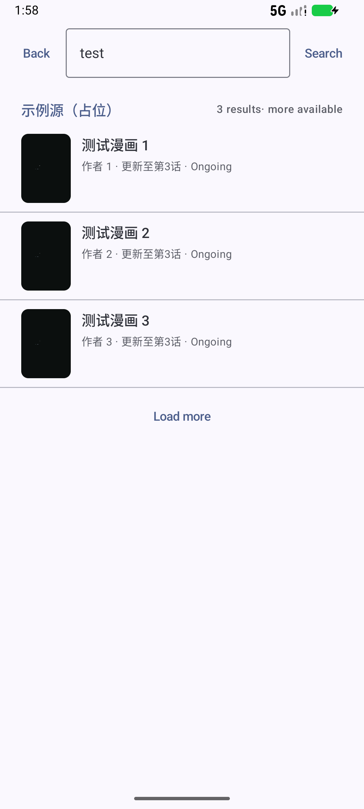
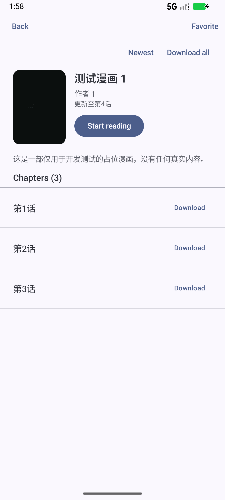

# v1.0.0 全链路验收记录

日期：2026-11-04 · 设备：Android 16 模拟器（Medium Phone API 36.1）· 包：`io.github.saonte.mangareader.debug`（debug，含本地假源）

> 本地假源 `tools/devserver`（`http://10.0.2.2:8765`）仅存在于 debug 构建，用于验证「无内置内容」下的完整链路。
> Release 包不含任何源与演示入口（见 [m7-security.md](m7-security.md) §2）。

## 六步验收

| # | 步骤 | 操作 | 结果 |
| --- | --- | --- | --- |
| 1 | 全新安装 → 导入规则 | `pm clear` 后由 DevInstallActivity 安装示例规则 | 规则管理显示 `community.example · v1.0.0`，启用 |
| 2 | 搜索 | 输入 `test` → 搜索 | 3 条结果，按源分组，显示「3 results · more available」与「Load more」 |
| 3 | 详情 | 点击结果 | 标题/作者/状态/简介/更新时间齐全，章节 3 话，`Newest` 排序 |
| 4 | 收藏 + 下载 | 点「Favorite」→ 第1话「Download」 | 收藏状态变「Favorited」；`files/Manga/downloaded/source_1/comic_1/chapter_1/001-003.png` 落盘 |
| 5 | 阅读 | 进入第1话 | 阅读器渲染第 1 页，菜单可打开，进度入库 |
| 6 | 离线重读 | 关闭 Wi-Fi + 数据 → 历史 → 详情 → 第1话 | 详情提示缓存可用，章节显示「Downloaded」，阅读器正常渲染本地图片 |

截图：

| 1 搜索 | 2 详情 | 3 下载 |
| --- | --- | --- |
|  |  |  |

| 4 阅读 | 5 离线详情 | 6 离线阅读 |
| --- | --- | --- |
|  |  |  |

## 关键判定

- **零内置内容**：release APK 内无规则、无源、无站点域名；链路依赖 debug-only 假源。
- **离线可用**（NFR-06）：断网后历史/详情/已下载章节均可用。
- **崩溃**：全流程 `logcat` 无 `FATAL EXCEPTION`、无 ANR。
- **性能**（NFR-01/04）：release 冷启动 786–1083ms；APK 2.7MB（见 [m7.md](m7.md)）。

## 发布签名验证（临时密钥）

为验证签名流程可用，使用本地生成的临时 keystore 构建并校验：

```bash
keytool -genkeypair -keystore release.jks -alias mangareader -keyalg RSA -keysize 4096 -validity 10000 ...
MANGA_KEYSTORE_FILE=release.jks MANGA_KEYSTORE_PASSWORD=... MANGA_KEY_ALIAS=mangareader MANGA_KEY_PASSWORD=...   ./gradlew :app:assembleRelease
apksigner verify --print-certs app/build/outputs/apk/release/app-release.apk
```

结果：

```
Signer #1 certificate DN: CN=MangaReader Verification, OU=Dev, O=Local, L=NA, ST=NA, C=CN
Signer #1 certificate SHA-256 digest: 7357d62af3fd5d74e9c44d9fb5c3a2e049b70fc2dbe85aebca01d152f58ec531
```

- 安装到模拟器：成功，冷启动 1018–1523ms，无 FATAL。
- 同签名 `install -r` 覆盖升级：成功。
- **注意**：该 keystore 仅为流程验证，未提交仓库（`.gitignore` 已排除 `*.jks`/`*.keystore`）；正式发布须由维护者生成并保存到密码管理器。

## 已知限制（不阻塞 v1.0）

| 项 | 说明 |
| --- | --- |
| 正式签名 | 需维护者提供 keystore；当前 release 用 debug 签名，仅可验证安装 |
| 真机矩阵 | 仅在模拟器验证（NFR-05 要求 ≥4 台真机） |
| Macrobenchmark | 未接入，性能数据来自 `am start -W` |
| TalkBack | 模拟器未预装，未做全流程走查 |
